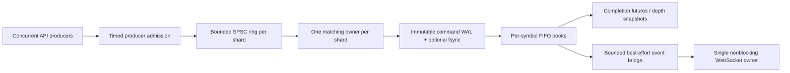

# TradeSim

A C++17 price/time-priority matching engine with **symbol-isolated shards, bounded concurrent ingress, replayable write-ahead journals, and a WebSocket command API**.

The interesting part is correctness under concurrency and recovery: immutable input commands reach the journal before matching; completed commands can be replayed into the same FIFO books; snapshots distinguish the current book hash from the journal's hash-chain tip.

## Build and test

Linux or macOS, CMake 3.20+, a C++17 compiler, and POSIX sockets/files. There are no third-party C++ dependencies. Python 3 enables the real WebSocket integration test and repeated benchmark helper.

```sh
cmake -S . -B build -DCMAKE_BUILD_TYPE=Release
cmake --build build --parallel 4
ctest --test-dir build --output-on-failure
```

Five CTest suites cover an independent reference matcher, concurrent producers, saturation/drain behavior, journal recovery and corruption, protocol parsing, live WebSocket clients, and benchmark conservation checks. Tests use explicit checks that remain enabled in release builds. CI runs Linux with AddressSanitizer/UBSan, macOS, and a separate ThreadSanitizer job.

## Run a trading session

```sh
# Four shards, memory-only:
./build/sharded_driver 4
# Four shards, journal + fsync before completion:
./build/sharded_driver 4 ./wal
```

Enter one command per line:

```text
N BTC-USD S 10000 10 DAY
N BTC-USD B 10000 4 IOC
P BTC-USD
C 7
```

The new-order ACK prints the generated ID; **use that ID when cancelling**, rather than assuming the illustrative `7` is correct. Prices are integer ticks and quantities are integer units, with no floating-point arithmetic. `px=0` means a market order: its unfilled remainder never rests. DAY limit residuals rest; IOC residuals cancel; FOK checks available level aggregates before mutating anything.

Symbols are case-sensitive ASCII identifiers of 1–16 letters/digits/`._-`. Price range: 0–10¹²; quantity range: 1–10⁹. A book has at most one million active orders. Each shard's ring has 4,095 usable slots and a 250 ms producer/queue admission budget after the lifecycle check. Capacity or internal failures return errors rather than silently losing commands.

## WebSocket API

```sh
# Memory mode:
./build/ws_tradesim 9001 4
# Durable journal mode:
./build/ws_tradesim 9001 4 ./wal
```

Connect to `ws://127.0.0.1:9001/ws`. Send JSON objects:

```json
{"type":"N","sym":"BTC-USD","side":"S","px":10000,"qty":10,"tif":"DAY"}
{"type":"N","sym":"BTC-USD","side":"B","px":10000,"qty":4,"tif":"IOC"}
{"type":"P","sym":"BTC-USD"}
{"type":"C","id":7}
```

- `N`/`C` produce an `ack` **after execution**, containing ID, per-shard sequence, remaining quantity, resting/cancelled flags, and `durability` (`memory` or `fsync`). An API submission ID alone is queue admission, not execution confirmation. `remaining` means unfilled quantity, which can be cancelled rather than resting; inspect `resting`.
- `P` returns `depth`: top ten bid/ask levels as `[price, aggregate_quantity, order_count]`, active-order count, sequence, state hash, and journal tip. The underlying snapshot/hash covers the complete book, not only the ten displayed levels.
- Trades are broadcast with symbol, resting/incoming IDs, shard, sequence, execution price, and quantity. Sequence numbers are **per shard**, not a global order across symbols. ACK and trade delivery can interleave.
- Invalid JSON, duplicate/unknown fields, invalid ranges, and unsupported commands produce an error without killing the server. `tif` defaults to DAY.

The server has one nonblocking network owner, up to 64 clients, an 8 KiB input buffer, 4 KiB incoming frame limit, 128 pending commands/client, 256 KiB outgoing buffer/client, and a two-second handshake deadline. It supports masked, unfragmented text frames, ping/pong, partial reads/writes, and extended payload lengths. Unsupported/oversized frames disconnect. Slow clients disconnect instead of blocking workers. Trade broadcasts are best-effort: the 4,096-event bridge drops overflow and prints its drop count on shutdown; ACKs are separately queued. Consumers must resynchronize from depth/journal state after disconnects or gaps.

This is a **limited WebSocket subset**, not a full RFC conformance implementation. No TLS, authentication, rate limit by identity, resumable feeds, replicated state, or execution-once client retry protocol is included. It binds to loopback. The JSON parser intentionally supports flat ASCII command objects with integer/string values; Unicode escapes, nesting, floats, and exponents are rejected. C++ IDs are uint64; the JSON command parser accepts positive signed-int64 numeric IDs, and JavaScript consumers must account for their own number precision limits.

## Verify and replay journals

```sh
./build/wal_verify ./wal/shard0.wal
# Optionally compare against a previously saved, independently trusted tip:
./build/wal_verify ./wal/shard0.wal TRUSTED_HEX_TIP
./build/wal_replay ./wal 4 BTC-USD
```

Starting an engine with an existing journal directory verifies and replays **all shards before accepting commands**, restores partial orders and cancellations, and advances the order-ID allocator. Shard topology is persisted and must match. A missing member of a partially present shard set is rejected. WAL files stay exclusively locked until the engine is destroyed, including after `stop()`.

Version 2 journals have an explicit header, bounded big-endian frames, contiguous per-shard command sequences, complete original order IDs/quantities/TIFs, and SHA-256 chaining over header/length/payload. The default durable mode checks every write and calls `fsync` before changing book state and before completing a command. New file directory entries are also synchronized. `EngineOptions{directory, false}` skips `fsync` and is not the same durability mode. Memory-only is the default when no directory is supplied.

A truncated record, pre-existing zero-byte file, bad hash, incompatible version, wrong topology, or competing writer stops recovery. **No silent tail repair** is performed. Legacy `.bin` logs cannot be replayed; preserve them separately. If an append/application failure occurs, later worker commands fail rather than continuing on uncertain state. Restart and offline verification are required.

A hash chain is **tamper-evident relative to a trusted checkpoint**, not an authenticated proof: an attacker can rewrite an entire chain; deleting whole final records or all logs is undetectable without independent tips/metadata. File sync behavior also depends on the OS/filesystem/device; the abrupt-process-exit test is not a physical power-loss test. Missing ACKs can still correspond to committed commands—client retries need a separate idempotency design.

## Architecture and performance evidence



Stable FNV-1a routes a symbol; IDs encode their shard so cancellations avoid broadcasting. Producer serialization preserves the SPSC contract—the whole engine is **not lock-free**. Ordered price maps preserve price priority; FIFO lists plus ID/iterator indexes remove the old linear scan on cancellation. Filled/cancelled orders release owned storage; historical command arenas no longer grow indefinitely. FOK checks use price-level aggregates.

```sh
./build/benchmark 1000000
python3 scripts/benchmark.py --orders 1000000 --trials 3 --output benchmark-results.json
```

The benchmark verifies trade/quantity conservation and empty terminal books. It separates single/multi-producer memory modes from per-command `fsync`, reports observed p50/p95/p99 completion latency, measures replay, and exercises random cancellations within one large price level. It is a synthetic closed-loop, **in-process** test with 64 outstanding requests/producer, not network throughput or a production capacity test.

See [recorded results](docs/BENCHMARKS.md), [raw trials](docs/benchmark-results.json), and [design decisions, failure boundaries, and limitations](docs/DESIGN.md).

## Sanitizer builds

```sh
cmake -S . -B build-asan -DTRADESIM_ASAN=ON -DCMAKE_BUILD_TYPE=RelWithDebInfo
cmake --build build-asan --parallel 4
ctest --test-dir build-asan --output-on-failure

cmake -S . -B build-tsan -DTRADESIM_TSAN=ON -DCMAKE_BUILD_TYPE=RelWithDebInfo
cmake --build build-tsan --parallel 4
ctest --test-dir build-tsan --output-on-failure -R core_invariants
```

Do not combine ASAN and TSAN or compare sanitizer throughput with release benchmarks. Idle shard workers currently yield/spin, so they consume CPU; adaptive parking and a dedicated latency/load harness are future work. Event sinks run on worker threads and must be short, nonblocking, and must not re-enter lifecycle methods. Cross-symbol atomic orders, balances/margin, self-trade prevention, checkpoint compaction, replication, and exchange-grade recovery orchestration are out of scope.
